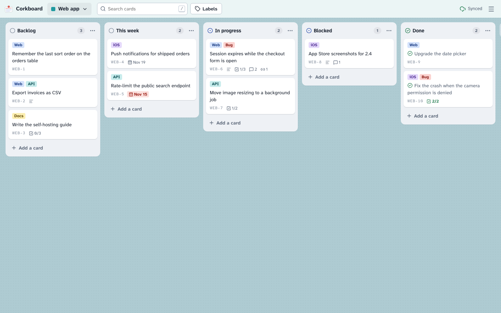
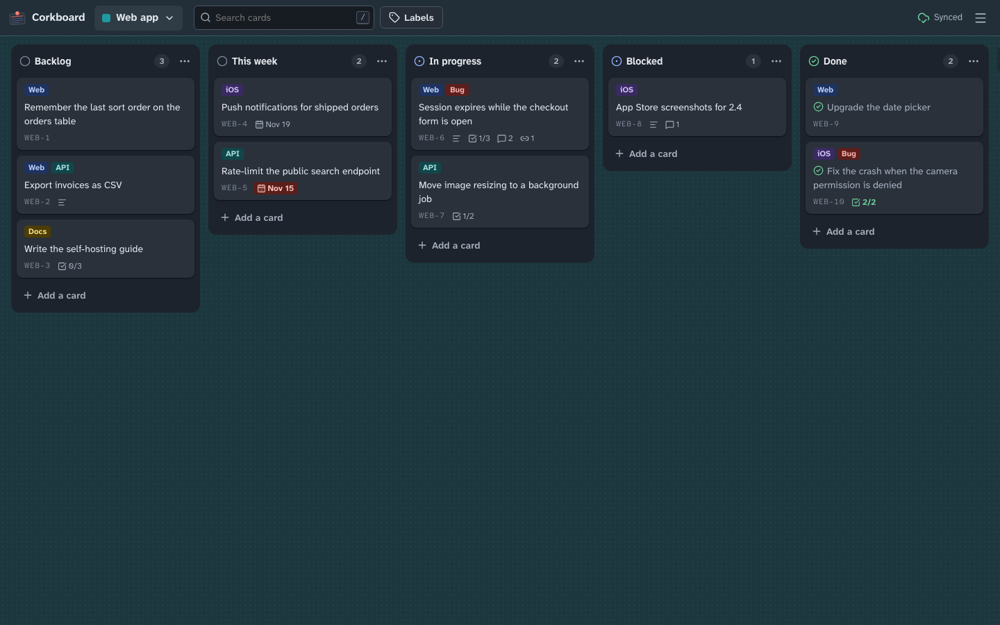
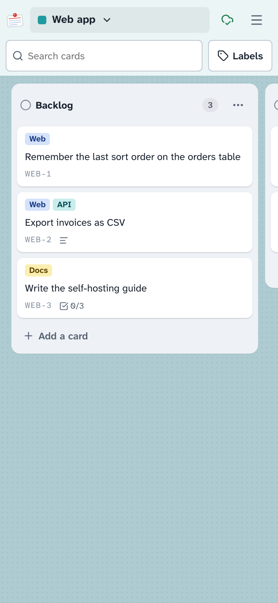

# Corkboard

[](https://github.com/trapp01/Corkboard/actions/workflows/ci.yml)
[](LICENSE)

A free, open-source kanban board that you host yourself, and that your AI
agents keep up to date while they work.



- **Boards, statuses, cards.** Statuses are the columns and you name them.
  Cards carry labels, a due day, a Markdown description, a checklist, links,
  attachments and comments. Drag a card to reorder it or to change its status.
- **Agents work from it.** The server answers AI assistants such as Claude
  Code at an MCP endpoint. An agent finds the card for its task, reads
  everything on it, moves it to In progress, ticks the checklist as it goes
  and leaves a comment when it stops. You watch the cards move.
- **One card is the whole picture.** `get_card` returns the description,
  checklist, links, comments and history as one Markdown document, written to
  be enough to pick the task up cold.
- **Your server.** Run one container on your homelab; every device syncs to
  it. No cloud account.
- **Or just the app.** The desktop app for macOS, Windows and Linux runs a
  server on your computer, so agents on that computer work from your boards
  with no homelab at all.
- **Works offline.** Every device keeps a full copy of the boards. Two
  devices can change the same card while both are offline and nothing is
  overwritten when they reconnect.
- **Start on one computer, move to a server later.** A server can follow
  another one, so boards tried out in the desktop app or with `pnpm start`
  join the homelab server without an export.
- **Goes with Looseleaf.** A card can link to a page in
  [Looseleaf](https://github.com/trapp01/Looseleaf), a notebook app built the
  same way, and shows the page's text. Notes and scopes live in the notebook;
  tasks and where they stand live on the board.

Corkboard is an early release. [docs/trello-parity.md](docs/trello-parity.md)
lists what is built and what is not. Keep your own backups of anything that
matters.

| Dark mode | Phone |
| --- | --- |
|  |  |

## Run it on your own computer

Two ways, both a Corkboard server on this computer that agents connect to:
the desktop app, which keeps the server reachable from this computer only,
or `pnpm start`, which serves every device on your network.

### Desktop app

There are no downloads yet; build it from a checkout (Node 22 and pnpm):

```sh
git clone https://github.com/trapp01/Corkboard.git && cd Corkboard
pnpm install
pnpm --filter @corkboard/web build
pnpm --filter @corkboard/desktop package   # the app lands in packages/desktop/out/
```

The app runs its own server at `http://127.0.0.1:8422`, on this computer only,
with its boards in the app's user data. First run asks whether to connect to a
server or keep boards on this computer only, then for your name; there is no
token to type. To sync with a server later, open Settings → **Sync** and enter
its address and access token: the app's server then keeps in step with it as
its upstream, so the boards follow you to other devices. Agents connect to the
app the same way as to any server: **Connect an assistant** shows the address
and token. If another program already uses port 8422 (a server started with
`pnpm start`, say), the app starts on another port and says so. The build is not signed;
[packages/desktop/README.md](packages/desktop/README.md) says how to open it
and has the rest.

### From the command line

Needs Node 22 and pnpm.

```sh
git clone https://github.com/trapp01/Corkboard.git && cd Corkboard
pnpm install
pnpm start        # builds, then serves http://127.0.0.1:8422 with data in ./data
```

The first start prints an access token. Open `http://127.0.0.1:8422`, enter
the token and your name, and make a board. The server answers other devices
on your network too; start it with `CORKBOARD_HOST=127.0.0.1` to keep it to
this computer.

To keep it running on a Mac from login,
[docs/launchd/com.corkboard.server.plist](docs/launchd/com.corkboard.server.plist)
is a LaunchAgent to copy; the steps are at its top.

## Run the server

```sh
git clone https://github.com/trapp01/Corkboard.git && cd Corkboard
docker compose up -d
docker compose logs corkboard   # prints the access token on first start
```

Open `http://<your-server>:8422` and enter the access token. Boards live in
the `data` volume as plain files; back that folder up however you back up
anything else. The server also keeps dated snapshots (14 by default).
Settings and the restore steps are in
[packages/server/README.md](packages/server/README.md).

To bring boards from the desktop app to the server, enter the server in the
app's Settings → **Sync**. For a copy started with `pnpm start`, restart it
with the server as its upstream:

```sh
CORKBOARD_UPSTREAM_URL=http://<your-server>:8422 CORKBOARD_UPSTREAM_TOKEN=<its token> pnpm start
```

The two then hold the same boards and stay in step.

Over plain `http` the browser keeps your changes while the server is
unreachable, but it cannot reopen the board with no network. For that, serve
it over HTTPS (`tailscale serve` does it in one command).

## Connect an agent

```sh
claude mcp add --transport http --scope user corkboard http://127.0.0.1:8422/mcp \
  --header "Authorization: Bearer <token>"
```

Then ask for something:

> Find the card for the login bug on the WEB board and start on it.

The agent reads the card, moves it to In progress and gets to work. Any MCP
client that can send a bearer token works the same way. The web client's
**Connect an assistant** dialog shows the command with your address and token
filled in. [docs/agents.md](docs/agents.md) has the tools, what an agent is
told to do with them, and how to pair the board with Looseleaf.

## Develop

Needs Node 22 and pnpm.

```sh
pnpm install
pnpm dev          # the web client with hot reload on :5173, over a dev server on :8423 (token: dev-token)
pnpm --filter @corkboard/desktop dev   # the desktop app, after pnpm --filter @corkboard/web build
pnpm test
pnpm typecheck
```

Start with [docs/architecture.md](docs/architecture.md) and
[docs/glossary.md](docs/glossary.md).

## Contributing

[CONTRIBUTING.md](CONTRIBUTING.md) has the setup and the rules.
[docs/trello-parity.md](docs/trello-parity.md) is the list of what is left to
build. Security problems go through [SECURITY.md](SECURITY.md).

## How it relates to Trello

Corkboard is an independent project. It is not affiliated with or endorsed by
Atlassian. Its layout follows Trello's because that layout is what most people
know a kanban board as; it contains no Trello code, artwork, colours or fonts.
Trello is a trademark of Atlassian.

Third-party fonts and icons are credited in
[THIRD-PARTY-NOTICES.txt](packages/web/public/THIRD-PARTY-NOTICES.txt), which
ships inside every build.

## Licence

[Mozilla Public License 2.0](LICENSE).
